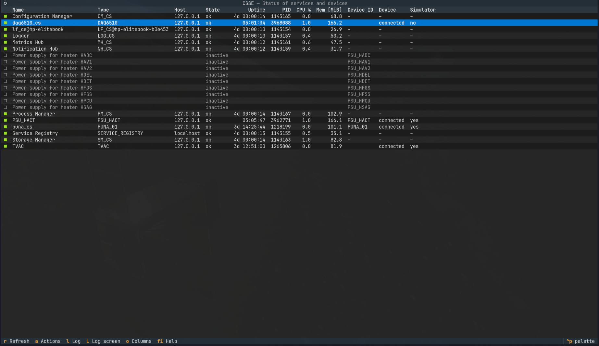
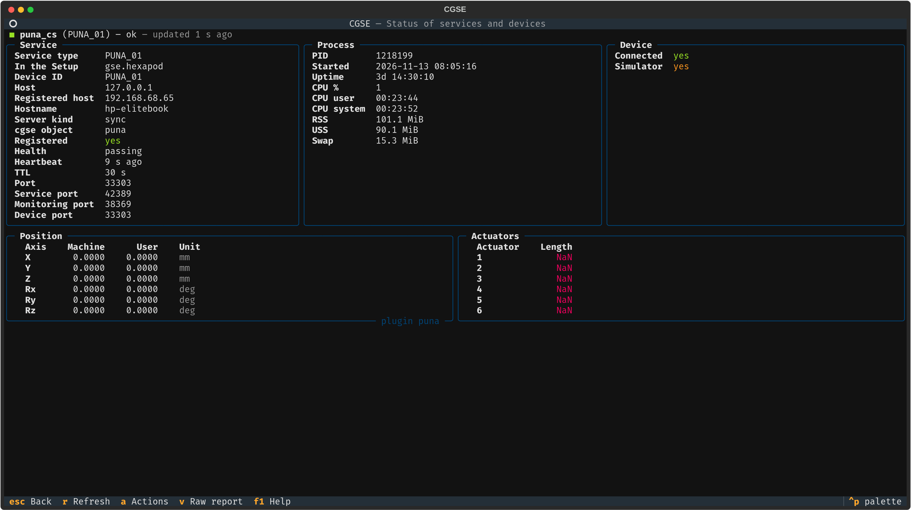
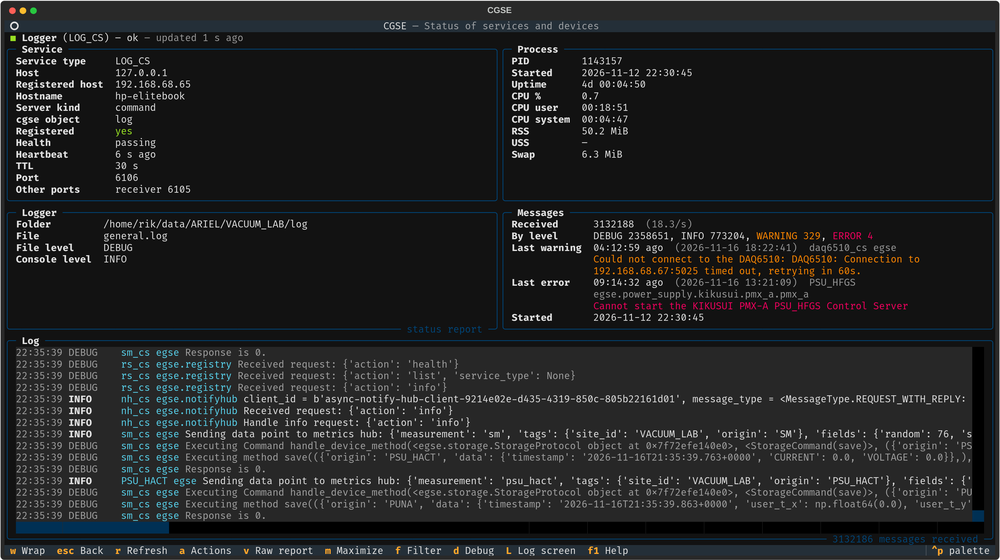
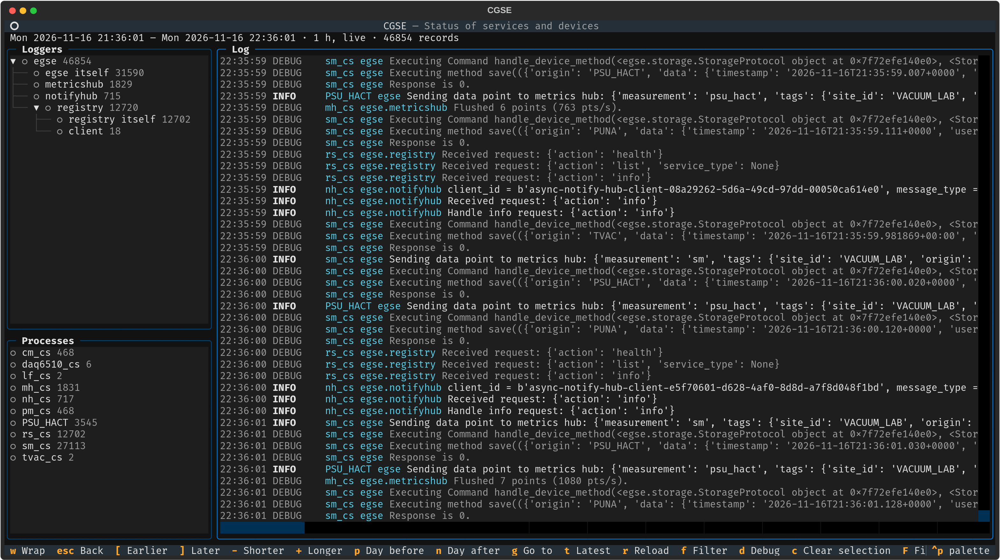
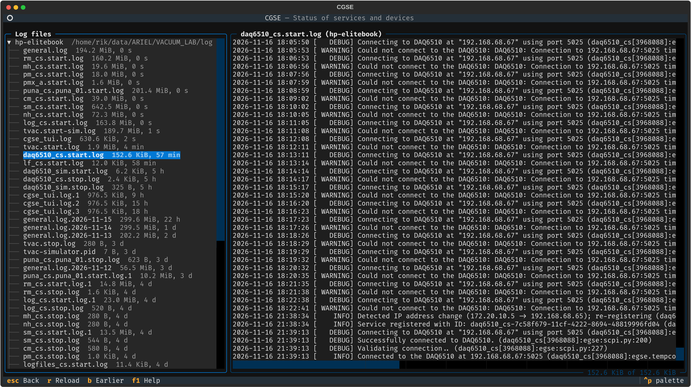
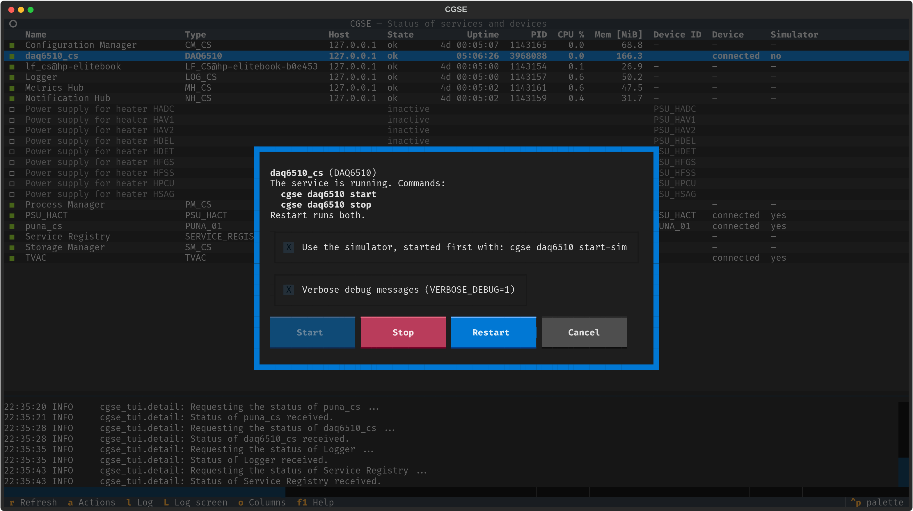

# The CGSE TUI

The CGSE TUI is a terminal dashboard of your test setup. It shows the core services (service registry, logger,
configuration manager, storage manager, process manager, notification hub and metrics hub) and the device control
servers on one screen: whether each one is running, whether it is connected to its device, and whether its process
uses too much CPU or memory. From the same screen you can start, stop or restart services and browse the log
messages and log files of the machines.

The TUI gets everything from the services themselves: the service registry tells which services run where, the
control servers publish their state every second, and the TUI asks the services for a status report. It changes
nothing by itself; starting, stopping and restarting a service is done on request, with `a`.

## Installation and start

The TUI is in the package `cgse-tui`, which is not installed with `cgse`:

```bash
uv add cgse-tui          # or: pip install cgse-tui
```

Start it with:

```bash
cgse tui                 # or the script cgse_tui
cgse tui --logs          # open the log screen right away
```

`ctrl+q` quits, `F1` shows the help on every screen. The help in the TUI has the same content as this page. All
messages of the TUI, also those of the client libraries, go to `cgse_tui.log` in the CGSE log file location.

## The overview



One row per service: the services in the registry, the core services that don't run, and the device drivers of the
project that don't run. The device drivers come from the Setup that the configuration manager has loaded: every node
with a `cgse_object`, see [The Setup](../libs/cgse-common/setup.md). A row that doesn't run is dimmed; `a` starts it.
The column "In Setup" (`o`) tells where a device is in the Setup. A problem with a device of the Setup, e.g. a
`device_id` that its running control server doesn't register, is logged as a warning.

### The coloured square

| Square      | Meaning                                                          |
|-------------|------------------------------------------------------------------|
| green       | running                                                          |
| orange      | running, but no connection with its device                       |
| red         | not responding (stale): no news within the stale time, see below |
| empty frame | not running                                                      |
| grey        | registered, but no information received yet                      |

A control server is stale when no monitoring message arrived for 5 s (or three times its publish interval, when
that is longer). The registry, the logger and the hubs are asked for their status every 2 s; they are stale after 8 s
without an answer. When the registry doesn't answer for 30 s, it is shown as not running and the services it had
registered are no longer considered registered.

### CPU and memory in orange or red

The TUI judges the process of every service:

- **CPU %**: the average over the last minute, orange from 50 %, red from 90 %. A short peak doesn't count.
- **Memory**: the growth of the memory over the last 10 minutes, judged once there are samples of 5 minutes: orange
  from 10 % growth, red from 25 % (a leak?). The memory is the resident memory (RSS) plus what is swapped out: leaked
  memory is never used again and ends up in swap, so the RSS alone can even go down while a process leaks. The swap
  is in the Process panel and in the column "Swap [MiB]" (`o`); a service of an older version doesn't report it.

The reason is shown in the Process panel of the detail screen, and a change is written in the log pane. The limits
are in `cgse_tui/data/health.py`.

### Keys

| Key      | Action                                                                                              |
|----------|-----------------------------------------------------------------------------------------------------|
| `enter`  | the detail screen of the selected service                                                           |
| `r`      | refresh: ask the registry and all services for their status now                                     |
| `a`      | start, stop or restart the selected service, see [Start, stop and restart](#start-stop-and-restart) |
| `o`      | choose the columns of the overview                                                                  |
| `l`      | show or hide the log pane                                                                           |
| `L`      | the log screen: the log messages of an hour, a day, ... from the log files                          |
| `m`      | in the log pane (`tab` gives it the focus): fill the screen, and back (`esc` too)                   |
| `w`      | in the log pane: wrap the long lines, and back (`left` and `right` scroll a long line)              |
| `F1`     | the help                                                                                            |
| `ctrl+q` | quit                                                                                                |

### Columns

`o` opens a list of all columns, also the ones that are not shown at start-up: ports, the registered address and the
host name of a service, CPU time, USS, Setup and obsid, the counters of the hubs, the heartbeat and health in the
registry, and more. `space` turns a column on or off, `a` selects all, `n` none, `d` the defaults; `esc` or `o` closes
the list. The change is applied right away, for as long as the TUI runs.

The Host column is the address the TUI connects to: `127.0.0.1` for a service on this machine, so it stays reachable
when the network is gone or changes address. The column "Registered host" has the address of the network interface
that the service registered.

### The log pane

Below the table: the state changes of the services (e.g. "Notification Hub: ok → stale"), the warnings about CPU and
memory, the progress of start, stop and restart, and other messages of the TUI. The log pane follows the new messages
while it's at the end; scrolled up, it stays at the same lines and its border says so (`end` follows again).

## The detail screen

The status of one service in panels, updated every second.



- **Service**: the registration in the registry (host, ports, health, heartbeat) and how the service is started
  (`cgse` object).
- **Process**: PID, uptime, CPU and memory, in orange or red with the reason, see above.
- **Device**: the connection with the device and whether it is a simulator; only for services with a device.
- **Details**: what is special about the service. The package of a device can show its own panels (e.g. the
  positions of a hexapod, the readings of the DAQ6510); the core services have their own panels; otherwise the
  details of the status report are shown as a tree. The border tells where the details come from: `live` (the
  monitoring messages, every second), `status report` (every 10 s) or the plugin.

The panels are dimmed when the service is stale or not running; the last information is kept.



Some detail screens have more:

- **Service registry**: the table of the registrations; `enter` opens the details of the selected service.
- **Process manager**: its core services with their state; `enter` opens their details.
- **Logger**: the messages by level, the last warning and error, and the last log lines at the bottom. The lines
  follow the new messages while the view is at the end; scrolled up, the view stays where it is (`end` follows
  again). `m` makes the log panel fill the screen, `m` or `esc` brings it back. `f` filters the lines on levels,
  process, logger or module, words in the message, and a time range (`14:05`, `2026-11-09 14:05`, or a time ago
  like `15m`). The text fields take comma separated words, `!word` leaves lines out. The lines that don't pass
  are hidden, or dimmed to keep their context (a checkbox in the dialog). `d` hides the DEBUG lines, also when
  the others are dimmed, and shows them again. The panel keeps the last 1000 messages, the filter applies to those,
  not to the log file.

| Key   | Action                                            |
|-------|---------------------------------------------------|
| `esc` | back                                              |
| `r`   | ask the service for its status report now         |
| `a`   | start, stop or restart the service                |
| `v`   | show the raw status report, and back              |
| `m`   | logger: the log panel fills the screen, and back  |
| `f`   | logger: filter the log lines                      |
| `d`   | logger: hide the DEBUG lines, and show them again |
| `w`   | logger: wrap the long log lines, and back         |
| `L`   | logger: the log screen                            |
| `F1`  | the help                                          |

## The log screen

`L` in the overview or in the detail screen of the logger, or `cgse tui --logs`: the log messages of a time window,
the latest hour at first. The logger reads them from its log files (`general.log` and the files of the days before)
with its `history` command, see [The Logger](../libs/cgse-core/logger.md), so the TUI can run on another machine. A
window has at most 50 000 messages; for a busy period, make it shorter.



The latest window is live: the new messages are added every 2 s (the `tail` of the logger) and the window moves with
the time, the oldest messages leave it. The view follows the new messages while it's at the end; scrolled up, it
stays where it is and its border says so (`end` follows again). An earlier window is not live, `t` goes back.

At the left the loggers of the messages in the window, as a tree on the dots in their names (`egse.hexapod.puna` is
below `egse.hexapod`), with the number of messages. `space` selects a logger with the loggers below it, only their
messages are shown then; `space` again deselects it, `c` clears the selection. "itself" is a logger without the
loggers below it, e.g. the plain `egse` logger. Below the tree the processes that logged the messages (e.g. `cm_cs`),
with their number of messages; `space` selects a process in the same way. With loggers and processes selected, a
message must be of both. `c` clears the selection in both. `tab` moves between the panes.

| Key     | Action                                                                  |
|---------|-------------------------------------------------------------------------|
| `[` `]` | the window before and after, by the length of the window                |
| `p` `n` | the same window a day earlier (yesterday) and a day later               |
| `-` `+` | a shorter and a longer window, from 5 min to 1 day, with the same start |
| `g`     | go to a time: `14:05`, `2026-11-09 14:05`, or a time ago like `2h`      |
| `t`     | the latest window, until now, live                                      |
| `end`   | the last message; in the live window: follow the new messages again     |
| `r`     | read the window again; the latest window then ends now                  |
| `space` | in Loggers or Processes: select or deselect a logger or a process       |
| `c`     | clear the selected loggers and processes                                |
| `f` `d` | filter the messages, hide the DEBUG messages, as in the detail screen   |
| `w`     | wrap the long lines, and back                                           |
| `F`     | the log files of the machines, see below                                |
| `esc`   | back                                                                    |

A logger of an older version can't read its log files: the screen says so, restart the logger to use it.

### The log files

`F` in the log screen: the files in the log folders of the machines, e.g. `puna_cs.puna_01.start.log` with the output
of `cgse puna start`, where the traceback of a service that doesn't start or stop ends up. Every machine runs a
log-files service for its own log folder (`cgse lf`, see [The Log-Files Service](../libs/cgse-core/logfiles.md)); the
start commands of the services start it. At the left the machines with their files, the most recently changed first;
`enter` shows a file from its end, and the view follows the new lines while it's at the end (`end` follows again).
`b` adds the part before it, up to 4 MiB, `r` reads the list of files again, `esc` goes back.



## Start, stop and restart

`a` opens a dialog with the actions that are possible for the service: start a service that isn't running, stop or
restart one that runs. It shows the `cgse` commands that will run, e.g. `cgse puna stop PUNA_01`: choosing an action
is the confirmation, `esc` cancels.



With the **simulator** checkbox the service is started with its simulator; it is checked when the service runs with
its simulator now. A simulator that is a separate process (e.g. DAQ6510, TVAC) is started first with
`cgse <object> start-sim` when it isn't running; other drivers are started with `--sim`.

With **verbose debug messages** the service (and its simulator) is started with `VERBOSE_DEBUG=1`: it also logs its
development traces, e.g. every message it receives, see [Logging](../dev_guide/logging.md). It is checked when the
TUI itself runs with `VERBOSE_DEBUG`; when it's not checked, the service is started without it.

The TUI then waits up to 30 s until the service is registered (start) or gone from the registry (stop), and writes the
result in the log pane. The commands run in their own session: the services started from the TUI keep running when
the TUI quits.

## Good to know

- The TUI reads, it doesn't control devices: device commands belong to the command line of a control server (e.g.
  `daq6510_cs start-scan`).
- The status reports of the control servers are requested every 10 s, the registry is asked every 2 s, the monitoring
  messages arrive every second; `r` asks for everything right away.
- A service that is alive but doesn't send heartbeats is dropped by the registry after about 50 s, and then
  disappears from the overview (a core service is shown as not running), although it runs.

## For developers

- A device package can show the details of its control server in its own way with a plugin in the entry-point group
  `cgse.tui.details`, see [Details in the TUI](../dev_guide/plugins.md#details-in-the-tui).
- The TUI finds a device driver by the `cgse_object` and `device_id` in the registration of its control server, see
  [The Service Registry](../libs/cgse-core/registry.md#the-metadata-of-a-registration), and starts and stops it with
  `cgse <object> start|stop [<device_id>]`, see
  [Sub-commands of a device](../dev_guide/plugins.md#sub-commands-of-a-device).
