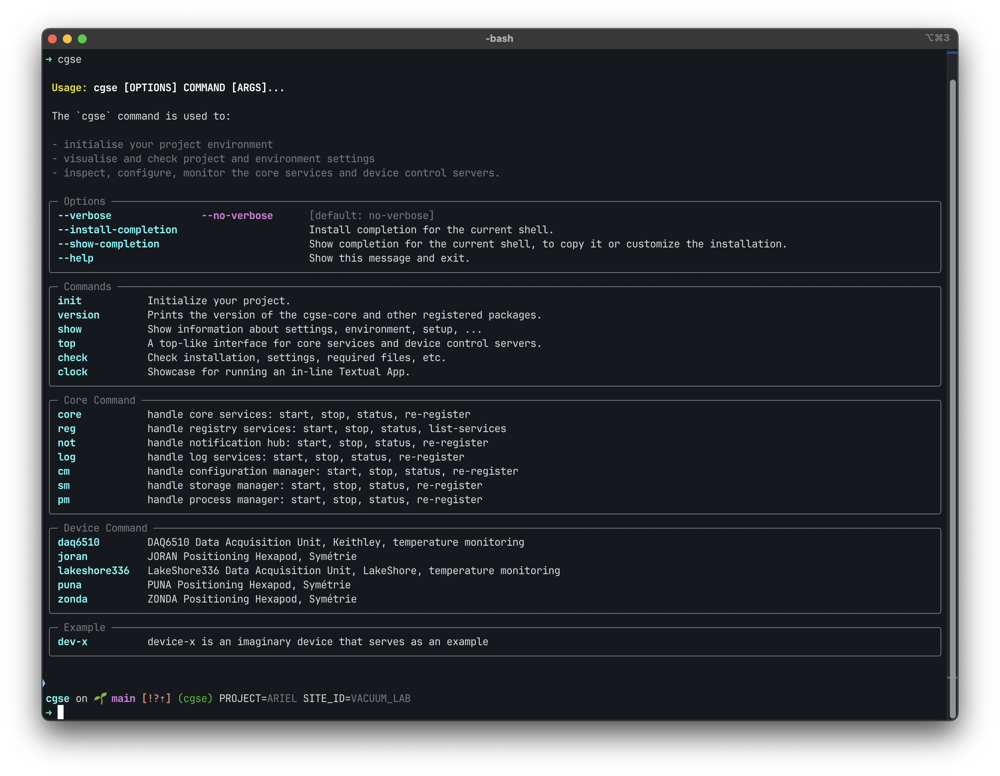

# CLI Commands CGSE

The CGSE comes with a suite of CLI commands to start and stop services, get 
status reports and check the installation. It's actually a suite of `cgse` 
sub-commands that is extendable by external packages. This section will 
describe the commands that are available from the `cgse` packages.

## The `cgse` command

When you run the `cgse` command without arguments, you will see something 
like this.

The _Options_ sections shows the global options to the CGSE command and allows you to activate auto-completion for all 
sub-commands.

The _Commands_ section lists the `cgse` commands that are not linked to a core service or a control server. 

The _Core Command_ section lists the sub-command for each of the core services, use `core` when you want to 
start/stop all core services in one go. The core services are:

- **reg** the service registry for all core services and control servers
- **nh** the notification hub that collects and publishes all events
- **log** the log server that collects and stores all log messages
- **cm** the configuration manager
- **sm** the storage manager
- **pm** the process manager
- **mh** the metrics hub that collects and forwards metrics

The _Device Command_ section lists the sub-commands for all device packages that have been installed and have a 
plugin for the `cgse` command. The `cgse` monorepo provides the following devices, each in its own package:

- **daq6510** the Keithley DAQ6510 Data Acquisition and Logging Multimeter (`keithley-tempcontrol`)
- **lakeshore336** the LakeShore 336 Temperature Controller (`lakeshore-tempcontrol`)
- **puna**, **joran**, **zonda** the Symétrie positioning Hexapods (`symetrie-hexapod`)
- **tgf4000** the Aim-TTi TGF4000 arbitrary function generator (`aim-tti-awg`)
- **pmx_a** the KIKUSUI PMX-A power supply (`kikusui-power-supply`)
- **rsd3305p** the RS PRO RS-D3305P power supply (`rs-pro-power-supply`)
- **dt8874** the Digilent MEASURpoint DT8874 (`digilent`)
- **tvac** the IvS Thermal Vacuum Chamber (`ivs-tvac`)
- **facility_hk** the housekeeping from the facility database (`ariel-facility`)
- **tcu** the ARIEL Telescope Control Unit (`ariel-tcu`)

Each device has the sub-commands `start`, `stop` and `status` to manage its control server. When the simulator of a
device runs as a separate process, there are also `start-sim`, `stop-sim` and `status-sim`, e.g.
`cgse daq6510 start-sim`. Other devices have a simulator that is part of the control server, start it with `--sim`,
e.g. `cgse puna start --sim PUNA_01`. Operations on the device itself are in the command of its control server,
e.g. `daq6510_cs start-scan`.

The _Example_ section lists devices that are purely there as examples on how to develop device drives and their 
plugins and how to use them in the framework.
